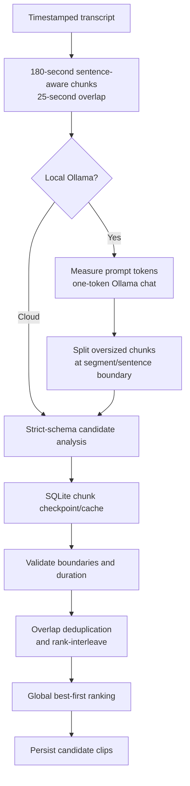

# AI and Transcription Pipeline

This guide covers AI Smart Clip and AI Mood Quotes. Quick Clip is separate and does not enter either AI path. Cloud transcription is planned, not implemented.

## Transcription

When generating candidates, worker checks source transcript cache against requested language and configuration fingerprint. Cache key includes decoding language (`auto-detect-v1`, `indonesia`, `english`) and preprocessing version `loudnorm-i20-tp15-lra11-v1`; model fingerprint includes resolved whisper-cli/model paths, file sizes, and modification timestamps when available.

On cache miss:

1. FFmpeg extracts audio, applies `loudnorm=I=-20:TP=-1.5:LRA=11`, converts to mono 16 kHz PCM WAV.
2. `whisper-cli` runs JSON output (`-oj`, `-of`) with explicit `-l auto`, `-l id`, or `-l en`.
3. Whisper segments and detected language are persisted to source row. Phrase-level timestamps are used; `-ml 1` word timestamps are not enabled.
4. Temporary WAV/JSON files are removed after use or worker cleanup.

Model location comes from `WHISPER_MODEL_PATH`; `small` is recommended from available Indonesian benchmark, `base` is a faster lower-accuracy option. AI Smart Clip uses Whisper on a transcript-cache miss. Quick Clip is the primary timestamp workflow and never initializes Whisper or Ollama.

## Highlight generation

`GenerateOptions` bounds count to 3/5/10 and duration to 15–30, 30–60, or 60–90 seconds. Current provider defaults: local Ollama (`qwen2.5:1.5b`), with optional OpenAI (`gpt-4o-mini`) or Gemini (`gemini-3.5-flash-lite`).

Flow:

### Chunk and context limits

- `transcript_chunks()` targets 180-second windows, favors sentence-ending punctuation, and carries up to roughly 25 seconds of overlap on measured segment boundaries.
- Local Ollama context is set to 4096 tokens, maximum output 1536, reserve 256; usable prompt budget is 2304 tokens.
- Ollama 0.40 has no tokenizer endpoint in this implementation. `count_prompt_tokens()` sends same prompt/schema with `num_predict=1`, then uses exact `prompt_eval_count` before inference.
- Oversized chunks split recursively near temporal midpoint, preferring sentence boundary; unsplittable oversized single segments fail rather than exceed limit.
- Chunks run sequentially. `analysis_chunks` stores candidate JSON, cache key, token count and timestamp. Retry copies checkpoints; only same chunk index and matching provider/model/schema/prompt key are reused.
- Candidate results interleave by each chunk's rank, then validate against source duration, configured range, chunk bounds, speech boundaries and overlap. A final ranking call selects/reorders global list.
- Short AI picks may expand only to neighboring transcript segment boundaries; timestamps are never invented.

### Provider privacy and errors

- Ollama URL is restricted to loopback (`127.0.0.1`, `localhost`, `::1`); service/model check is up to three one-second attempts.
- Local provider has no cloud fallback. Missing Ollama/model or timeout returns local error.
- OpenAI/Gemini jobs require explicit `consent=true`, configured backend key and record `consent_at`. Retry requires fresh consent. Video/audio never sent to AI providers.
- Gemini 429 stops the job; app does not upgrade billing, automatically retry or switch provider.
- API keys are backend environment only; settings UI shows whether key exists, never the value.

## Mood Quotes generation

Mood categories, stable slugs, descriptions, subcategories, writing styles, perspectives, length targets, music moods, fonts, and visual templates live in `mood_quotes.py` and are returned by `GET /api/mood-quotes/categories`. No category data is duplicated across UI components.

`POST /api/mood-projects/{id}/generate` supports Gemini (default when `GEMINI_API_KEY` is configured) or OpenAI (`OPENAI_API_KEY`/`OPENAI_MODEL`). If Gemini is absent and OpenAI is configured, new drafts default to OpenAI; this is initial configuration selection, not runtime fallback. Local Ollama is not offered. Every request requires `consent=true`; backend records provider/model, input settings, usage counts when returned, and `consent_at` in `mood_generations`. Keys are never stored in SQLite or returned to the browser. A configured provider is called only when explicitly selected; missing key, timeout, quota/rate limit, or HTTP error returns an error without retry or provider switch.

The request sends mood/category/subcategory, optional custom topic, style, point of view, target duration band, language, and generation instructions. It never sends uploaded/source video, background image/video, music, draft assets, or provider credentials. Prompt treats custom topic as untrusted subject data and asks for five distinct original alternatives, no famous-quote attribution or song lyrics, short visual segments, visual keywords, and a recommended music mood.

Structured response schema in `QUOTE_SCHEMA` requires exactly five objects with title, final text, ordered segments, mood/tone IDs, visual keywords, and one of ten music moods. `validate_quotes()` enforces strict properties, text lengths, exact normalized reconstruction, ordered indices, known IDs, and near-duplicate rejection. Usable provider segments feed Sequential Text; otherwise `mood_text.py` performs local deterministic sentence/clause splitting and word-weighted timing. Short opening clauses (for example “Terkadang,”) merge into following phrase, and split candidates avoid leading/trailing conjunctions. Manual segments remain untouched unless user invokes confirmed **Segmentasi ulang**. Extremely short duration can still make readable segmentation impossible; editor warns about reading time and long segments rather than rewriting quote text. Editing, timing, reset, preview, visual recommendation/preset selection, and render never call AI. `mood_visuals.py` maps stable mood/category IDs to recommended visual styles deterministically; no provider call or automatic preset application occurs. Music mood remains recommendation, not asset selection. Invalid provider output is not persisted or retried automatically.

Each successful batch is appended to `mood_generations`; current results point to a generation ID. `mood_favorites` stores quote snapshots independently, so regenerate cannot erase saved favorites/history. Editing/selecting a quote writes the draft; editor, preview, and FFmpeg render do not call AI again. Mood quote generation is request-scoped rather than a worker job; FFmpeg render is queued in the shared local FIFO worker.

## Recorded benchmark evidence

Results are sample/workstation-specific, not product guarantees. Hardware/runtime audit was recorded 22 Oct 2026: Windows 11 Pro build 26200, Intel i3-9100F (4C/4T), 15.9 GiB RAM, RX 570 4 GiB, Python 3.10.6, whisper.cpp v1.9.5 CPU build, Ollama 0.40.8 and Qwen 1.5B Q4_K_M. The 149.53 s FLEURS sample used 13 human-read Indonesian clips concatenated with 250 ms gaps; its test MP4 used synthetic FFmpeg `testsrc2` video.

### Earlier local app run (Whisper `base`)

| Source | Whisper | Ollama analysis | Total generate | Peak tracked RSS |
|---|---:|---:|---:|---:|
| 149.5 s | 41.1 s | 47.0 s | 88.7 s | 1.57 GiB |
| 300 s | 61.0 s | 21.6 s (3 chunks) | 83.7 s | 2.20 GiB |

### Long-context token-bounded analysis

Cached transcripts used for analysis-only test; Whisper did not run in this comparison.

| Input | Segments | Chunks | AI analysis | Candidates | Max prompt tokens | Peak tracked RSS |
|---|---:|---:|---:|---:|---:|---:|
| 149.5 s FLEURS | 19 | 1 | 18.6 s | 3/5 | 792 | not sampled |
| 1545.7 s local transcript | 266 | 15 | 43.6 s | 5/5 | 1436 | 1.65 GiB |

Long retry reused 15 chunks and globally reranked in 8.9 seconds. The short FLEURS sample returned only 3 of 5 requested candidates; count is not guaranteed.

### Indonesian transcription accuracy

Same 149.53 s / 13-segment FLEURS `id_id/test` sample, official text aligned by clip ID and waveform position. WER/CER use NFKC, lowercase, punctuation removal and whitespace collapse; CER includes spaces.

| Model | Language setting | Detected | WER | CER | Runtime range / run | Peak RSS |
|---|---|---|---:|---:|---:|---:|
| `base` | forced `id` | `id` | 35.54% | 15.84% | 19.6–34.0 s | 410 MiB |
| `base` | `auto` | `id` | 35.54% | 15.84% | 24.54 s | 410 MiB |
| `small` | forced `id` | `id` | 19.01% | 11.27% | 49.6–84.7 s | 876 MiB |
| `small` | `auto` | `id` | 19.01% | 11.27% | 104.94 s | 875 MiB |

This small sample favored `small`; it is read speech, not conversational Indonesian. No subjective listening was performed, so reference/audio errors remain possible. Separate direct-CLI preprocessing runs on the same reference:

| Audio preprocessing | Model | WER | CER | Runtime |
|---|---|---:|---:|---:|
| Native mono 16 kHz | `base` | 35.54% | 15.84% | 19.64 s |
| Native mono 16 kHz | `small` | 19.01% | 11.27% | 49.55 s |
| Resampled mono 22.05 kHz | `base` | 32.64% | 10.68% | 18.02 s |
| Resampled mono 22.05 kHz | `small` | 19.83% | 10.91% | 48.88 s |
| Duplicated stereo | `base` | 38.43% | 16.55% | 17.10 s |
| Mono 16 kHz + `loudnorm=I=-20:TP=-1.5:LRA=11` | `base` | 31.82% | 11.09% | 17.96 s |
| Mono 16 kHz + `loudnorm=I=-20:TP=-1.5:LRA=11` | `small` | 15.29% | 3.74% | 49.73 s |

Reference sample mean volume was −25.3 dBFS with peak 0 dBFS. Normalization improved this sample for both models; duplicated stereo worsened `base`; 22.05 kHz gave mixed results. These are direct CLI experiments, not a generalized corpus benchmark. FLEURS clips are human-read and concatenated with gaps.

### Actual local application UAT

Recorded 4-minute Indonesian source: `small`, requested `auto`, detected `id`, 40 transcript segments, four candidates, generate job 132.03 s (Whisper phase 87.89 s), peak tracked process RSS 1.56 GiB. Clean 720p rank-1 render took 2.66 s and decoded H.264/AAC, 9:16, 0.02 s A/V duration delta; manual subtitle correction rerendered in 3.29 s without transcription/AI rerun. Qwen produced Chinese candidate reasons in this Indonesian run. Human audio review was unavailable; likely ASR errors remain. Do not treat subtitles as human-verified.

Recorded output still contained likely ASR misspellings. No subjective audio review was performed; human verification remains required before publication.

## Limitations

- No diarization, word timestamps, translation, or speech-to-text cloud service is implemented.
- Sentence/segment timestamps lead to phrase-level Highlight captions; long segments can wrap into multi-line subtitle blocks.
- Prompt and model results vary by input and model; text model does not guarantee coherent or culturally accurate candidate explanations.
- Quick Clip timestamp workflow is implemented in [Features and Workflows](features-and-workflows.md); it bypasses this AI pipeline. Future Cloud Transcription remains planned in [Roadmap](roadmap.md).

For user flow see [Features and Workflows](features-and-workflows.md); test commands and non-verified cases are in [Testing and Troubleshooting](testing-and-troubleshooting.md).
