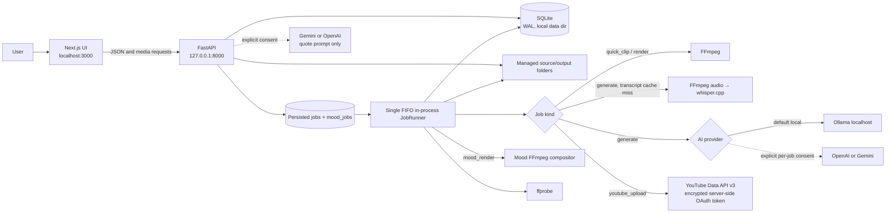

# Architecture

Klipnara Studio is a Windows-first, single-user, local-first desktop web application. The browser UI is a Next.js client; FastAPI owns persistence and processing. Media, SQLite, credentials, and job state live on the user's machine. YouTube publishing is available for source-backed clips. Optional OpenAI/Gemini requests send transcript prompts for AI Smart Clip or mood/topic/style prompts for Mood Quotes; no source, background, or music asset is sent to quote providers.

## System view

The worker is serial: it selects the oldest queued job, claims it transactionally, then handles transcription/analysis, rendering, or YouTube upload. It polls due YouTube processing records only when no queued job is available. SQLite remains source of truth across process restart; job recovery marks interrupted jobs failed and publication recovery preserves resumable session state.

## Code boundaries

| Area | Source | Responsibility |
|---|---|---|
| HTTP API and lifecycle | `backend/clipper/main.py` | FastAPI models/routes, validation, startup, settings and capability report |
| Configuration and paths | `backend/clipper/config.py` | Environment-backed data, media and temporary roots |
| SQLite | `backend/clipper/db.py` | Schema creation/migrations, WAL and connection context |
| Job worker | `backend/clipper/jobs.py` | Single FIFO worker across source-backed `jobs` and source-less `mood_jobs`; progress, cancellation, retry, render dispatch, YouTube processing polls |
| Candidate logic | `backend/clipper/analysis.py` | Timestamp chunking, prompt schemas, candidate validation, overlap removal, global ranking |
| Provider adapters | `backend/clipper/providers.py` | Local Ollama, OpenAI, Gemini, token preflight and errors |
| Mood quote catalog and validation | `backend/clipper/mood_quotes.py` | Stable mood categories, prompt schema, originality constraints, strict quote/segment validation |
| Mood text timing | `backend/clipper/mood_text.py` | Local deterministic segmentation, weighted timing, sequence warnings; no provider calls |
| Mood project API | `backend/clipper/mood_studio.py` | Draft JSON composition, generation/favorite/asset/render tables, explicit provider consent, project/asset validation and output review/download |
| Mood timeline helpers | `frontend/lib/mood-timeline.mjs`, `frontend/lib/mood-draft.mjs` | Timeline mapping/snapping, segment edits, music span, serialized autosave queue; no backend timeline model |
| Media operations | `backend/clipper/media.py`, `mood_renderer.py` | Secure URL fetch, ffprobe, Whisper, ASS typography/segment animation, audio/output validation and FFmpeg export |
| YouTube | `backend/clipper/youtube.py` | OAuth, DPAPI, tokens, resumable sessions, retries and status reconciliation |
| UI | `frontend/app/`, `frontend/components/shell.tsx` | Ingest, candidate/editor/review, accounts, history and diagnostics |

## Persistence and file boundaries

- Default Windows data root is `%LOCALAPPDATA%\Klipnara`; non-Windows fallback is `~/.klipnara`. SQLite database and temporary worker files are under this root.
- `CLIPPER_SOURCE_DIR` and `CLIPPER_CLIP_DIR` independently override original-video and render roots. Existing legacy managed folders remain readable.
- Transcripts, transcript fingerprints, candidates, edits, source jobs, provider usage, chunk checkpoints, YouTube accounts and publication records are in SQLite. Mood Quotes uses separate `mood_projects`, `mood_generations`, `mood_favorites`, `mood_assets`, `mood_jobs`, and `mood_renders`; it has no fake `sources` or `clips` row. Uploaded mood assets and rendered MP4s remain local files; Source Library background video is referenced, not copied.
- Source/clip routes restrict paths to managed roots. URL ingest resolves every redirect to public IPs and pins HTTPS connections to resolved addresses.
- YouTube access/refresh tokens and resumable session URLs are DPAPI ciphertext in SQLite; OAuth client secret remains in backend environment. The browser receives channel metadata and publication metadata, never OAuth credentials.

## Important technical decisions

- **Local-first, one worker:** simple persistent queue avoids concurrent Whisper/Ollama/FFmpeg load on the target workstation. Trade-off: only one heavy job runs at a time; YouTube processing polls pause while queue contains work.
- **SQLite checkpoints:** analysis chunks and resumable upload state survive retries/restarts without a hosted queue or database. YouTube's partial unique index prevents duplicate active/published uploads for the same account and exact rendered file hash.
- **Approval fingerprints:** `reviewed_render_sha256` binds approval to exact MP4 bytes. Changed edits, new render, or migrated old approval clears/requires fingerprint.
- **DPAPI:** Windows user-scoped encryption avoids adding a crypto dependency or storing a portable key next to database. Moving data to another Windows account requires reconnecting YouTube.
- **FFmpeg remains media engine:** x264 is used for 720p; tested RX 570 AMF encoder is used for 1080p. 1080p requires compatible FFmpeg/AMD driver.
- **Quick Clip shares schema/renderer:** timestamp jobs reuse existing `jobs`/`clips` tables and FFmpeg render path; no transcript, schema migration, or second editor is needed.
- **Mood Quotes has a separate content model:** mood drafts and render records do not satisfy the existing `clips.source_id` relationship. Additive tables retain draft history, favorites, assets, render state and SHA-256 review without altering V1.1/V2.0 rows.
- **Mood composition stays in JSON:** text mode, segment timing/animation, versioned cinematic visual settings, and music offset/mute/trim/fades live in `mood_projects.composition_json`; no SQLite table migration is needed. Timeline selection, zoom, and snap stay in UI state. Render jobs keep immutable quote/composition snapshots. Missing `text_mode` means legacy Single Text; missing visual/music fields load safe defaults. New drafts default to Sequential Text.
- **One FIFO for both render families:** existing source-backed jobs and source-less `mood_jobs` are claimed by the same serial worker and lock. Mood AI generation stays request-scoped, with explicit per-request cloud consent and no fallback; render jobs never call AI/Whisper/Ollama.
- **Step 3 preview is not a render:** React updates text styling immediately; video backgrounds request a debounced, cached FFmpeg still frame. Step 4 remains full motion/audio preview. Safe Area is UI-only and excluded from FFmpeg output.
- **AI limits:** local Ollama prompts are measured and bounded before inference; no implicit cloud fallback. Cloud providers need explicit consent and receive transcript-only content.

## Runtime dependencies

Backend application dependencies: FastAPI, Uvicorn, python-multipart. Development/test extras: httpx and psutil. Frontend dependencies: Next.js, React, lucide-react and TypeScript. FFmpeg/ffprobe, whisper.cpp/model, Ollama/model, Gemini/OpenAI keys, and Google OAuth credentials are external runtime configuration, not bundled dependencies. Mood Quotes visual preset schema/data and deterministic mood recommendations live in `mood_visuals.py`; frontend receives preset config from existing Mood Quotes config endpoint. The existing `mood_renderer.py` handles new filtergraph effects. Mood Quotes supports Windows system fonts (Arial, Georgia, Segoe UI, Tahoma, Trebuchet MS, Times New Roman); it does not package third-party font files. YouTube OAuth encryption uses Windows DPAPI via Python `ctypes`.

Gyan FFmpeg audit build contains GPL components including libx264; review build licensing before redistribution. Klipnara does not bundle FFmpeg or AI model files.

## Component selection and licensing notes

- **whisper.cpp (MIT):** selected as a Windows/CPU-compatible local subprocess with multilingual timestamped segments. Word-level `-ml 1` is experimental and not enabled; current editor uses segment timestamps.
- **Ollama (MIT) + Qwen `qwen2.5:1.5b` (Apache-2.0):** selected for local structured output. The app bounds local context and checks service/model instead of switching to a cloud provider.
- **FFmpeg:** selected at runtime for probe, audio extraction, crop, ASS burn-in and H.264/AAC render. FFmpeg source is LGPL 2.1+; enabling GPL components such as libx264 makes that built distribution GPL. Check the license of the chosen build.
- **Not reused:** AutoClip brought Python/dependency/platform mismatch and functionality beyond MVP; auto-editor focuses on silence/editing rather than semantic highlight choice; ClipsAI uses a heavier WhisperX/Torch/diarization stack. No project code from these tools is vendored.
- Direct application package licenses recorded in repository audit: Next.js/React MIT, lucide-react ISC, TypeScript Apache-2.0, FastAPI/Pydantic MIT, Uvicorn BSD-3-Clause, python-multipart Apache-2.0; test-only psutil BSD-3-Clause.

See [Getting Started](getting-started.md) for local setup and [API and Database](api-and-database.md) for persisted schemas and routes.
