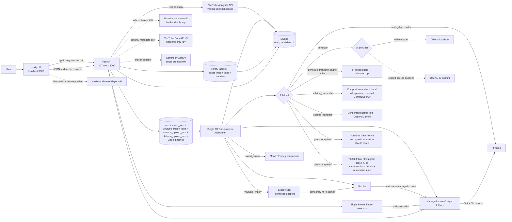

# Architecture

Klipnara Studio is a Windows-first, single-user, local-first desktop web application. The browser UI is a Next.js client; FastAPI owns persistence and processing. Media, SQLite, credentials, analytics cache, and job state live on the user's machine. YouTube Clip previews validated URLs in the official IFrame Player. Optional local segment import is disabled by default and requires explicit configuration, external yt-dlp/FFmpeg/ffprobe, and user confirmation that acquisition/use are permitted. yt-dlp is not official YouTube tooling; no cookie/session, DRM bypass, or access-control workaround is used. Optional YouTube Data API metadata is fetched server-side and not persisted. YouTube Publishing Studio handles approved Clip and Mood outputs through one OAuth/resumable uploader; native schedules are delegated to YouTube. V3.1 Analytics queries official YouTube Analytics reports only for OAuth-verified channel accounts, then caches responses locally and attributes only known publication video IDs. V3.2 adds conditional TikTok Inbox transfer and Facebook Login for Business Instagram resumable Reels publishing; direct TikTok posting stays disabled, and manual export remains available. Highlight/Mood/translation cloud requests send text only; optional cloud subtitle transcription uploads composition audio only after explicit per-request consent.

V3.2.1 supports multiple connected destinations per provider. OAuth grants and provider accounts remain separate records; each publication snapshots account ID, authorization ID, and stable provider identity. Metadata drafts can override shared defaults per account. Fan-out creates independent jobs, so one destination can fail without discarding another. Disconnect cancels queued work for that account, preserves history, and keeps grants shared by remaining destinations. Google grants returning multiple YouTube channels remain fail-closed; `prompt=select_account` supports connecting separate Google identities.

## System view

The render/publish worker is serial: it transactionally claims oldest queued clip, Mood, YouTube import/upload, or social upload job. Source-backed YouTube uploads reuse `jobs`; Mood and social publishing use separate rows. Social jobs recheck approval, fingerprint, media, account state, and scopes before bytes transfer. Interrupted social operations become `needs_reconciliation`; no automatic resend occurs when provider outcome is unknown. Due TikTok/Instagram and YouTube status checks run only when no queued job is available. Batch orchestration persists `video_batches`/`video_batch_items`, enqueues only one child render per batch, and advances from worker completion hooks; child renders still use existing source clip/Mood renderers. Restart recovery marks interrupted children retryable and batches paused. Pexels media import uses a separate single-thread executor, one import at a time; its persisted job row survives restart and interrupted jobs fail retryably with scoped temporary cleanup. Successful Pexels videos become ordinary managed `sources`, so Quick Clip and Mood reuse existing files. SQLite remains source of truth across restart.

## Code boundaries

| Area | Source | Responsibility |
|---|---|---|
| HTTP API and lifecycle | `backend/clipper/main.py` | FastAPI models/routes, validation, startup, settings and capability report |
| Configuration and paths | `backend/clipper/config.py` | Environment-backed data, media and temporary roots |
| SQLite | `backend/clipper/db.py` | Schema creation/migrations, WAL and connection context |
| Job worker | `backend/clipper/jobs.py` | Single FIFO worker across source-backed `jobs`, source-less `mood_jobs`, `youtube_import_jobs`, `youtube_upload_jobs`, and `platform_upload_jobs`; progress, cancellation, batch lifecycle hooks, render/upload dispatch, provider status polls |
| Optional YouTube segment adapter | `backend/clipper/youtube_import.py` | Strict canonical URL/timestamp checks, opt-in yt-dlp argv, partial-section request, output-size/duration/ffprobe checks, cancellation and temp cleanup |
| Candidate logic | `backend/clipper/analysis.py` | Timestamp chunking, prompt schemas, candidate validation, overlap removal, global ranking |
| Provider adapters | `backend/clipper/providers.py` | Local Ollama, OpenAI, Gemini, token preflight and errors |
| YouTube Clip URL/metadata/import API | `backend/clipper/youtube_clip.py`, `backend/clipper/youtube_import.py`, `backend/clipper/main.py` | Strict URL/ID/timestamp parser; bounded official metadata; opt-in job lifecycle and local partial-section adapter |
| Mood quote catalog and validation | `backend/clipper/mood_quotes.py` | Stable mood categories, prompt schema, originality constraints, strict quote/segment validation |
| Mood text timing | `backend/clipper/mood_text.py` | Local deterministic segmentation, weighted timing, sequence warnings; no provider calls |
| Mood project API | `backend/clipper/mood_studio.py` | Draft JSON composition, generation/favorite/asset/render tables, explicit provider consent, project/asset validation and output review/download |
| Shared Asset Library | `backend/clipper/asset_library.py`, `backend/clipper/pexels.py` | Local media metadata/uploads, safe deletion/reuse, Pexels API adapter/search/favorites/import lifecycle and backend-only key |
| Batch orchestration | `backend/clipper/batch_studio.py`, `backend/clipper/db.py`, `backend/clipper/jobs.py` | Batch/item persistence, snapshots, one-child scheduling, controls, restart recovery and output links; delegates rendering/review to existing workflows |
| Mood timeline helpers | `frontend/lib/mood-timeline.mjs`, `frontend/lib/mood-draft.mjs` | Timeline mapping/snapping, segment edits, music span, serialized autosave queue; no backend timeline model |
| Clip scene timeline | `frontend/lib/clip-timeline.mjs`, `frontend/app/clips/[id]/page.tsx` | Source/output mapping, ordered scene edits, cut-range ripple delete, bounded history, browser seek preview and autosave; no separate renderer |
| Clip Editor workspace | `frontend/app/clips/[id]/page.tsx`, `frontend/lib/clip-editor-state.mjs`, `frontend/app/globals.css` | Shared Quick/AI Smart/YouTube output editor layout, sticky browser preview, preview transport, responsive stacking, and draft/render status derived from existing API state |
| Media operations | `backend/clipper/media.py`, `mood_renderer.py` | Secure URL fetch, ffprobe, Whisper, ASS typography/segment animation, audio/output validation and FFmpeg export |
| Subtitle workflow | `backend/clipper/subtitles.py`, `main.py`, `jobs.py`, `media.py`, `frontend/lib/word-pop.mjs` | SRT/VTT parsing, fingerprints, queued composition transcription/translation, reviewed word alignment, stale checks, live Word Pop preview and per-word ASS events |
| YouTube publishing | `backend/clipper/youtube.py` | OAuth and actual scope persistence, channel verification, DPAPI, Clip/Mood output gates, immutable attribution snapshots, resumable sessions, schedules, thumbnails and events |
| YouTube Analytics | `backend/clipper/youtube_analytics.py`, `main.py` | Official report query/parsing, per-channel cache, dashboard/video/retention summaries, comparisons, and sample-gated rule insights |
| Social publishing | `backend/clipper/platform_publishing.py`, `backend/clipper/db.py`, `backend/clipper/jobs.py`, `backend/clipper/main.py` | Conditional TikTok Inbox and Instagram resumable Reels flows, separate account scopes/jobs/events, explicit approval/rights, safe status reconciliation, and manual export |
| Publishing Studio | `frontend/app/publishing/page.tsx`, `frontend/app/accounts/page.tsx` | Approved-output queue, per-platform metadata/actions, YouTube schedule/history, conditional social transfer/publish history, manual export, thumbnails, separate channel/Klipnara analytics, charts, and CSV export |
| UI | `frontend/app/`, `frontend/components/shell.tsx` | Ingest, candidate/editor/review, Publishing Studio, accounts, history and diagnostics |
| YouTube Clip UI | `frontend/components/youtube-clip-flow.tsx`, `youtube-clip-player.tsx`, `frontend/lib/youtube-clip.mjs` | URL, IFrame preview, timestamp validation, automatic-import progress/cancel/retry, local fallback, existing Quick Clip forwarding |

The clip editor is one client route for source-backed Quick Clip, AI Smart Clip, and YouTube Clip output. Desktop grid keeps controls and preview as sibling regions; sticky preview uses the shell's 62px topbar offset and has no overflow-clipping ancestor. The workspace wrapper ends before the timeline, so sticky bounds remain local. Tablet/mobile stacks preview before controls and disables sticky positioning. `compositionTime` and existing timeline mapping remain the playhead source of truth; visual edits update browser overlays without changing the video key. Draft persistence, render queue, review fingerprint and publishing remain on existing API paths. Mood Quotes keeps its separate workspace and project/render records.

## Persistence and file boundaries

- Default Windows data root is `%LOCALAPPDATA%\Klipnara`; non-Windows fallback is `~/.klipnara`. SQLite database and temporary worker files are under this root.
- `CLIPPER_SOURCE_DIR` and `CLIPPER_CLIP_DIR` independently override original-video and render roots. `SOURCE_DIR/library-assets` stores shared images/audio; video remains in canonical `sources`. Existing legacy managed folders remain readable.
- Transcripts, transcript fingerprints, candidates, edits, source jobs, provider usage, chunk checkpoints, YouTube/Pexels import/publish state, actual OAuth grant scopes, immutable publication attribution, six-hour reusable Analytics responses, metadata drafts/templates/events/thumbnails, asset metadata/favorites, accounts and publication records are in SQLite. Subtitle tracks/styles live in existing `clips.edit_json`; subtitle audio stays in temporary work files and is removed after transcription. `library_assets` is additive shared metadata; source-backed video remains canonical in `sources`, while images/audio live once under managed `library-assets`. Mood assets can reference shared assets without copying. Existing project-owned Mood files remain supported and are not migrated. Quick Clip stores canonical URL/video ID/original timestamps/source association in existing `jobs.options_json`; metadata is transient. Mood Quotes uses separate project tables and no fake `sources`/`clips` rows. V2.9 adds batch/item tables; batch children reference existing clip/Mood drafts and store immutable render snapshots/fingerprints, not media copies. Mood publishing uses `youtube_upload_jobs` rather than fake source rows.
- Source/clip routes restrict paths to managed roots. URL ingest resolves every redirect to public IPs and pins HTTPS connections to resolved addresses.
- YouTube and social access/refresh tokens plus provider resumable URLs are DPAPI ciphertext in SQLite; OAuth client secrets remain in backend environment. The browser receives safe account metadata and job status, never OAuth credentials/session ciphertext.
- Analytics consent is channel-bound to an existing verified account. OAuth scope persistence records only Google-returned grants; missing grants fail closed. Report queries derive channel ID from local account ID, not caller-provided channel IDs. Reports are non-monetary and cached locally; disconnect removes corresponding cache rows.

## Important technical decisions

- **Local-first, one worker:** simple persistent queue avoids concurrent Whisper/Ollama/FFmpeg load on the target workstation. Trade-off: only one heavy job runs at a time; YouTube processing polls pause while queue contains work.
- **SQLite checkpoints:** analysis chunks and resumable upload state survive retries/restarts without a hosted queue or database. YouTube's partial unique index prevents duplicate active/published uploads for the same account and exact rendered file hash.
- **Approval fingerprints:** `reviewed_render_sha256` binds approval to exact MP4 bytes. Changed edits, new render, or migrated old approval clears/requires fingerprint.
- **DPAPI:** Windows user-scoped encryption avoids adding a crypto dependency or storing a portable key next to database. Moving data to another Windows account requires reconnecting YouTube.
- **FFmpeg remains media engine:** x264 is used for 720p; tested RX 570 AMF encoder is used for 1080p. 1080p requires compatible FFmpeg/AMD driver.
- **Quick Clip shares schema/renderer:** timestamp jobs reuse existing `jobs`/`clips` tables and FFmpeg render path; no transcript, schema migration, or second editor is needed.
- **Clip scenes stay in `edit_json`:** ordered stable-ID source ranges, audio/title/export settings, and subtitle timebase are saved in existing `clips.edit_json`; render jobs keep an immutable edit snapshot in `jobs.options_json`. Output timestamps derive from scene order. Single-scene drafts retain trim defaults; no migration or source rewrite is needed.
- **Subtitle drafts stay additive:** generated/imported/manual/translated tracks, language selections, and caption styles extend `clips.edit_json`; no schema migration or automatic activation. Output-time tracks are tied to source hash and composition fingerprint. Translation freshness uses source cue IDs/text/timing. New async jobs reuse existing `jobs`/worker; legacy synchronous route remains available.
- **Word Pop timing is explicit:** reviewed per-word text/times stay inside subtitle segments in `clips.edit_json`; no DB migration or inferred timing. Gemini word timestamps may be used; segment-only/text-only results require manual alignment. Cue text/timing edits keep word data but clear review. API and render both fail closed for missing, mismatched, overlapping, or unreviewed words. ASS emits one event per mapped word, preserving scene timebase/cuts; presets only change appearance.
- **Cut Range is composition-only:** output interval maps into intersected source ranges, fragments remain scenes, and later scenes shift left because output positions are recomputed. Bounded 40-entry Undo/Redo stays in the editor; source files remain unchanged.
- **Preview stays browser-side:** one source `<video>` seeks through ordered intervals; scrubbing does not enqueue FFmpeg work. Final Multi-Scene output reuses the serial render worker, normalizes scene PTS/size/FPS and audio sample format, then concatenates hard cuts. Limit is one source, 12 scenes, 180 seconds; no crossfade or full multi-track composition.
- **YouTube import is optional, not official:** adapter runs only on explicit user action after administrator opt-in and rights attestation. It passes a canonical URL and selected interval to yt-dlp `--download-sections`; `--ignore-config` prevents ambient yt-dlp config from injecting cookies/options. Adapter never reads browser credentials or bypasses access controls. Partial transfer may be unavailable or include extra bytes. It validates output and stores a local source, then uses existing Quick Clip route/worker/editor. Provenance is removable; no existing source/draft is deleted.
- **Mood Quotes has a separate content model:** mood drafts and render records do not satisfy the existing `clips.source_id` relationship. Additive tables retain draft history, favorites, assets, render state and SHA-256 review without altering V1.1/V2.0 rows.
- **YouTube publishing keeps content models separate:** approved Mood renders use `youtube_upload_jobs` without fake source rows; approved Clips retain existing `jobs` rows. Both dispatch through same OAuth, serial worker and resumable uploader. Per-output confirmation and review fingerprint remain mandatory.
- **Social publishing stays conditional and separate:** TikTok requests `user.info.basic`/`video.upload` only; Inbox delivery needs creator action and is not Published. No `video.publish` or Direct Post. Instagram local resumable upload requires linked Professional account, verified permissions, and Facebook Login for Business; Instagram Login `video_url` flow is not assumed. Provider readiness never implies app review/eligibility. Manual export remains independent and always available.
- **YouTube Analytics uses official, channel-bound reports:** `youtube.readonly` verifies channel identity and authorizes `reports.query`; `yt-analytics.readonly` permits Analytics reports. Actual grants are stored and preserved across incremental consent. Channel-wide metrics and locally attributed publication-video metrics never mix; Views and Engaged Views stay separate. Six-hour cache, 30-day retention, one-video retention requests, and local CSV export avoid a second auth or chart dependency.
- **Production attribution is a publication-time snapshot:** new `youtube_publications.attribution_json` stores a compact, sanitized workflow/render-settings record. Old rows remain explicitly unattributed; the app does not reconstruct historical settings from current drafts.
- **Asset Library wraps existing source storage:** videos remain normal `sources` IDs for Quick Clip compatibility. Mood links shared files through `mood_assets` and restrictive foreign keys; deleting a referenced asset is blocked. Local imports are hash-deduplicated. Pexels search uses official fixed HTTPS API, backend-only credentials and bounded search-result cache; explicit MP4 import pins public-host DNS/HTTPS, limits size, probes output, and registers or reuses one normal source. No scraping, bulk download, or AI processing.
- **Mood composition stays in JSON:** text mode, segment timing/animation, versioned cinematic visual settings, and music offset/mute/trim/fades live in `mood_projects.composition_json`; no SQLite table migration is needed. Timeline selection, zoom, and snap stay in UI state. Render jobs keep immutable quote/composition snapshots. Missing `text_mode` means legacy Single Text; missing visual/music fields load safe defaults. New drafts default to Sequential Text.
- **One FIFO for both render families:** existing source-backed jobs and source-less `mood_jobs` are claimed by the same serial worker and lock. Mood AI generation stays request-scoped, with explicit per-request cloud consent and no fallback; render jobs never call AI/Whisper/Ollama.
- **Native YouTube schedules are not local jobs:** YouTube receives timezone-aware `publishAt` with Private visibility; local worker only confirms remote processing/status and does not publish on a timer.
- **Step 3 preview is not a render:** React updates text styling immediately; video backgrounds request a debounced, cached FFmpeg still frame. Step 4 remains full motion/audio preview. Safe Area is UI-only and excluded from FFmpeg output.
- **AI limits:** local Ollama prompts are measured and bounded before inference; no implicit cloud fallback. Cloud providers need explicit consent. Highlight/Mood/translation send text; optional STT sends audio only after separate explicit consent.

## Runtime dependencies

Backend application dependencies: FastAPI, Uvicorn, python-multipart. Development/test extras: httpx and psutil. Frontend dependencies: Next.js, React, lucide-react and TypeScript. FFmpeg/ffprobe, optional external yt-dlp, whisper.cpp/model, Ollama/model, Pexels/Gemini/OpenAI keys, and Google OAuth credentials are not bundled. Subtitle local STT needs configured whisper.cpp; cloud STT/translation use backend keys and explicit per-request consent. YouTube import requires `YOUTUBE_IMPORT_ENABLED=1`, `YT_DLP_PATH`, FFmpeg and ffprobe. Pexels search is optional and reads `PEXELS_API_KEY` on backend only. Mood Quotes fonts are system-provided; OAuth encryption uses Windows DPAPI via Python `ctypes`.

Gyan FFmpeg audit build contains GPL components including libx264; review build licensing before redistribution. Klipnara does not bundle FFmpeg or AI model files.

## Component selection and licensing notes

- **whisper.cpp (MIT):** selected as a Windows/CPU-compatible local subprocess with multilingual timestamped segments. Word-level `-ml 1` is experimental and not enabled; current editor uses segment timestamps.
- **Ollama (MIT) + Qwen `qwen2.5:1.5b` (Apache-2.0):** selected for local structured output. The app bounds local context and checks service/model instead of switching to a cloud provider.
- **FFmpeg:** selected at runtime for probe, audio extraction, crop, ASS burn-in and H.264/AAC render. FFmpeg source is LGPL 2.1+; enabling GPL components such as libx264 makes that built distribution GPL. Check the license of the chosen build.
- **Not reused:** AutoClip brought Python/dependency/platform mismatch and functionality beyond MVP; auto-editor focuses on silence/editing rather than semantic highlight choice; ClipsAI uses a heavier WhisperX/Torch/diarization stack. No project code from these tools is vendored.
- Direct application package licenses recorded in repository audit: Next.js/React MIT, lucide-react ISC, TypeScript Apache-2.0, FastAPI/Pydantic MIT, Uvicorn BSD-3-Clause, python-multipart Apache-2.0; test-only psutil BSD-3-Clause.

See [Getting Started](getting-started.md) for local setup and [API and Database](api-and-database.md) for persisted schemas and routes.
