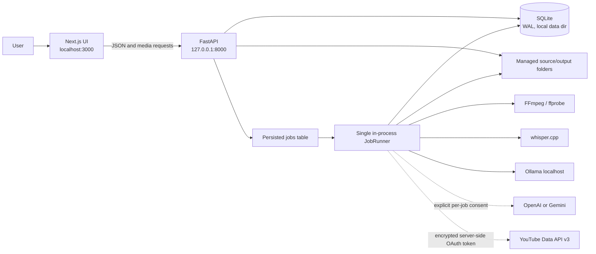

# Architecture

Klipnara is a Windows-first, single-user, local-first desktop web application. The browser UI is a Next.js client; FastAPI owns persistence and processing. Media, SQLite, credentials, and job state live on the user's machine. Google YouTube APIs are the only required remote service for YouTube publishing; optional OpenAI/Gemini requests contain transcript data, not source media.

## System view

The worker is serial: it selects the oldest queued job, claims it transactionally, then handles transcription/analysis, rendering, or YouTube upload. It polls due YouTube processing records only when no queued job is available. SQLite remains source of truth across process restart; job recovery marks interrupted jobs failed and publication recovery preserves resumable session state.

## Code boundaries

| Area | Source | Responsibility |
|---|---|---|
| HTTP API and lifecycle | `backend/clipper/main.py` | FastAPI models/routes, validation, startup, settings and capability report |
| Configuration and paths | `backend/clipper/config.py` | Environment-backed data, media and temporary roots |
| SQLite | `backend/clipper/db.py` | Schema creation/migrations, WAL and connection context |
| Job worker | `backend/clipper/jobs.py` | Single FIFO worker, progress, cancellation, retry, AI/render dispatch, YouTube processing polls |
| Candidate logic | `backend/clipper/analysis.py` | Timestamp chunking, prompt schemas, candidate validation, overlap removal, global ranking |
| Provider adapters | `backend/clipper/providers.py` | Local Ollama, OpenAI, Gemini, token preflight and errors |
| Media operations | `backend/clipper/media.py` | Secure URL fetch, ffprobe, Whisper invocation, subtitles and FFmpeg render |
| YouTube | `backend/clipper/youtube.py` | OAuth, DPAPI, tokens, resumable sessions, retries and status reconciliation |
| UI | `frontend/app/`, `frontend/components/shell.tsx` | Ingest, candidate/editor/review, accounts, history and diagnostics |

## Persistence and file boundaries

- Default Windows data root is `%LOCALAPPDATA%\Klipnara`; non-Windows fallback is `~/.klipnara`. SQLite database and temporary worker files are under this root.
- `CLIPPER_SOURCE_DIR` and `CLIPPER_CLIP_DIR` independently override original-video and render roots. Existing legacy managed folders remain readable.
- Transcripts, transcript fingerprints, candidates, edits, jobs, provider usage, chunk checkpoints, YouTube accounts and publication records are in SQLite. Original media and render MP4s remain files.
- Source/clip routes restrict paths to managed roots. URL ingest resolves every redirect to public IPs and pins HTTPS connections to resolved addresses.
- YouTube access/refresh tokens and resumable session URLs are DPAPI ciphertext in SQLite; OAuth client secret remains in backend environment. The browser receives channel metadata and publication metadata, never OAuth credentials.

## Important technical decisions

- **Local-first, one worker:** simple persistent queue avoids concurrent Whisper/Ollama/FFmpeg load on the target workstation. Trade-off: only one heavy job runs at a time; YouTube processing polls pause while queue contains work.
- **SQLite checkpoints:** analysis chunks and resumable upload state survive retries/restarts without a hosted queue or database. YouTube's partial unique index prevents duplicate active/published uploads for the same account and exact rendered file hash.
- **Approval fingerprints:** `reviewed_render_sha256` binds approval to exact MP4 bytes. Changed edits, new render, or migrated old approval clears/requires fingerprint.
- **DPAPI:** Windows user-scoped encryption avoids adding a crypto dependency or storing a portable key next to database. Moving data to another Windows account requires reconnecting YouTube.
- **FFmpeg remains media engine:** x264 is used for 720p; tested RX 570 AMF encoder is used for 1080p. 1080p requires compatible FFmpeg/AMD driver.
- **AI limits:** local Ollama prompts are measured and bounded before inference; no implicit cloud fallback. Cloud providers need explicit consent and receive transcript-only content.

## Runtime dependencies

Backend application dependencies: FastAPI, Uvicorn, python-multipart. Development/test extras: httpx and psutil. Frontend dependencies: Next.js, React, lucide-react and TypeScript. FFmpeg/ffprobe, whisper.cpp/model, Ollama/model, and Google OAuth credentials are external runtime configuration, not bundled dependencies. YouTube OAuth encryption uses Windows DPAPI via Python `ctypes`.

Gyan FFmpeg audit build contains GPL components including libx264; review build licensing before redistribution. Klipnara does not bundle FFmpeg or AI model files.

## Component selection and licensing notes

- **whisper.cpp (MIT):** selected as a Windows/CPU-compatible local subprocess with multilingual timestamped segments. Word-level `-ml 1` is experimental and not enabled; current editor uses segment timestamps.
- **Ollama (MIT) + Qwen `qwen2.5:1.5b` (Apache-2.0):** selected for local structured output. The app bounds local context and checks service/model instead of switching to a cloud provider.
- **FFmpeg:** selected at runtime for probe, audio extraction, crop, ASS burn-in and H.264/AAC render. FFmpeg source is LGPL 2.1+; enabling GPL components such as libx264 makes that built distribution GPL. Check the license of the chosen build.
- **Not reused:** AutoClip brought Python/dependency/platform mismatch and functionality beyond MVP; auto-editor focuses on silence/editing rather than semantic highlight choice; ClipsAI uses a heavier WhisperX/Torch/diarization stack. No project code from these tools is vendored.
- Direct application package licenses recorded in repository audit: Next.js/React MIT, lucide-react ISC, TypeScript Apache-2.0, FastAPI/Pydantic MIT, Uvicorn BSD-3-Clause, python-multipart Apache-2.0; test-only psutil BSD-3-Clause.

See [Getting Started](getting-started.md) for local setup and [API and Database](api-and-database.md) for persisted schemas and routes.
